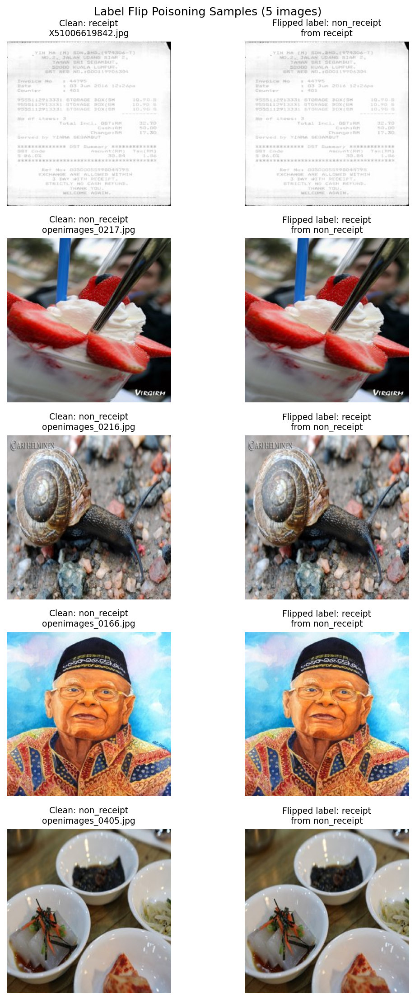
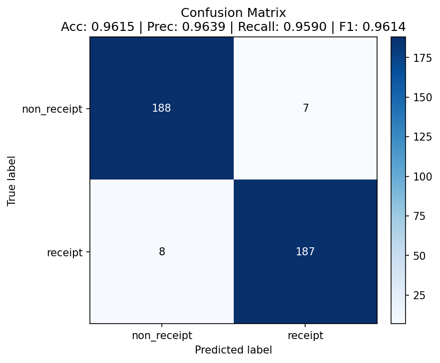
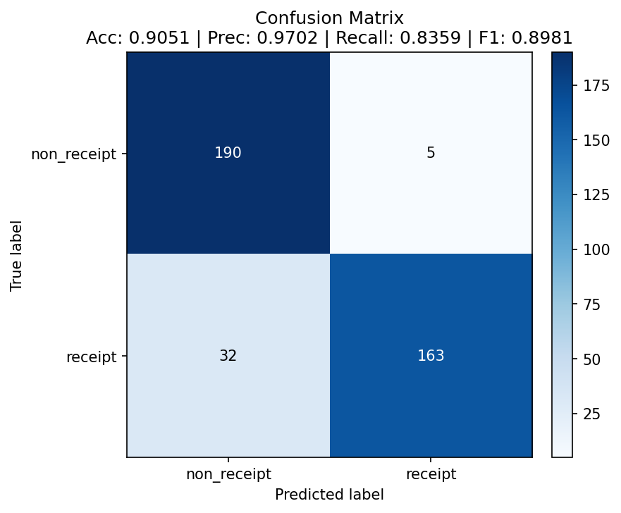

# Data Poisoning Results

## Attack Configuration

- **Method:** Label-flip poisoning
- **Flip rate:** 8% per class (`--flip-rate 0.08`), random seed 42
- **Labels flipped:** 92 out of 1,154 training images (7.97%): 46 receipt → non_receipt, 46 non_receipt → receipt
- **Goal:** Show that mislabeling a small fraction of the training data, without changing any images, is enough to change how the model behaves on a clean test set.

## Label Flip Evidence

As you can see from the above images, the attack changed the image labels, not the images.

## Baseline (Clean Model)

**Methodology note:** The baseline is a clean model retrained in the test environment (`receipt_cnn_clean_retrain_check.pt`), not the release checkpoint (`receipt_cnn_clean.pt`). The release checkpoint was trained in a different environment (likely GPU hardware and different software versions), and it scores lower on the same test set (accuracy 0.9436). The retrained baseline uses the same `train.py` settings, hardware and software as the poisoned model, so the label flips are the only difference between the two. Training in this environment is deterministic: retraining the poisoned model reproduced its metrics exactly. For reference, the drop measured against the release checkpoint is 3.85 points (0.9436 → 0.9051).

| Metric | Value |
|--------|-------|
| Accuracy | 0.9615 |
| Precision | 0.9639 |
| Recall | 0.9590 |
| F1 Score | 0.9614 |

## Poisoned Model

| Metric | Value |
|--------|-------|
| Accuracy | 0.9051 |
| Precision | 0.9702 |
| Recall | 0.8359 |
| F1 Score | 0.8981 |

## Impact Analysis

| Metric | Clean | Poisoned | Change |
|--------|-------|----------|--------|
| Accuracy | 0.9615 | 0.9051 | −0.0564 |
| Precision | 0.9639 | 0.9702 | +0.0063 |
| Recall | 0.9590 | 0.8359 | −0.1231 |
| F1 | 0.9614 | 0.8981 | −0.0634 |

## Confusion Matrices

## Key Findings

1. How significant is the accuracy drop? Accuracy fell from 96.2% to 90.5%, a drop of 5.64 percentage points, and the total number of test errors more than doubled (15 → 37).

2. Which class was more affected and why? receipt. Real receipts rejected as non-receipts (false negatives) went from 8 to 32, so recall fell from 95.9% to 83.6%. About 1 in 6 genuine receipts is now rejected. Non-receipts accepted as receipts actually fell slightly (7 → 5). The flips were even (46 each way), so the imbalance comes from how the model learned from them. The 46 relabelled non-receipts are varied photos (cars, scenes, objects) with little in common, so the model learns less from them.

3. What do the confusion matrices tell you? The clean model's errors were balanced: 7 non-receipts accepted and 8 receipts missed. The poisoned model's errors are lopsided: 32 of its 37 errors are missed receipts. The poisoning added errors and pushed the model toward rejecting real receipts.

4. What are the implications of this attack? Someone who can influence the training data can weaken the classifier without touching any images. In this run the damage is to legitimate claims: about 1 in 6 genuine receipts would be wrongly rejected.
